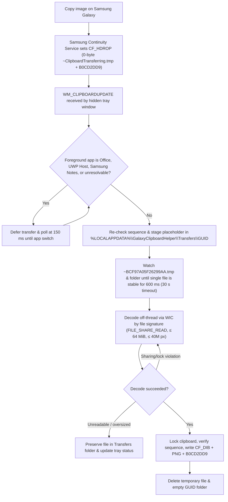

<div align="center">

# Galaxy Clipboard Helper

**Automatically turn Samsung Galaxy Continuity clipboard placeholders into real Windows images (`PNG` & `CF_DIB`) — so `Ctrl+V` works everywhere.**

[-0078D4?style=flat-square&logo=windows&logoColor=white)](#requirements)
[](#build-from-source)
[-2EA44F?style=flat-square)](#key-features)
[](#key-features)
[](./LICENSE)

**English** · [한국어](./docs/README.ko.md)

[Why This Exists](#why-this-exists) · [Key Features](#key-features) · [How It Works](#how-it-works) · [Getting Started](#getting-started) · [System Tray Menu](#system-tray-menu) · [Architecture](#architecture) · [Troubleshooting & FAQ](#troubleshooting--faq)

</div>

---

**Galaxy Clipboard Helper** is a lightweight, standalone Windows system tray utility written in Rust (Win32 + WIC). It monitors Samsung Continuity Service clipboard transfers in the background and converts Samsung's temporary placeholder files into real `PNG` and `CF_DIB` clipboard images — without keyboard hooks, fake `Ctrl+V` keystrokes, Explorer window automation, or patching Samsung binaries.

## Why This Exists

When you copy an image on a Samsung Galaxy phone or tablet with **Clipboard sharing** (`Samsung Continuity Service`) enabled, Windows does not receive a standard `PNG` or bitmap immediately. Instead, Samsung places a **0-byte placeholder file** (`~ClipboardTransferring.tmp`) on the clipboard as a file drop (`CF_HDROP`) alongside a Samsung sync tag (`B0CD2DD9`).

Samsung Continuity Service only starts transferring the real image from your Galaxy device when that placeholder is written into a destination folder (for example, pasting in File Explorer or using dedicated integrations in Microsoft Office / Samsung Notes).

| Paste Target (`Ctrl+V`) | Without Galaxy Clipboard Helper | With Galaxy Clipboard Helper |
| :--- | :--- | :--- |
| **Browsers & Web Apps** (Chrome, Edge, Notion, Figma, Discord, Slack) | Pastes a `.tmp` file path or fails to paste | Pastes a real **`PNG`** image (preserving transparency) |
| **Image Editors & Legacy Win32 Apps** (Paint, editors, chat apps) | Rejects `.tmp` file drop or does nothing | Pastes a standard **`CF_DIB`** bitmap or **`PNG`** |
| **Microsoft Office & Samsung Notes** | Direct Samsung insertion works | **Still works natively** — helper automatically defers while focused |
| **Runtime & Background Impact** | — | Single **~332 KiB** `.exe`, event-driven (`WM_CLIPBOARDUPDATE`), zero idle polling |

## Key Features

- **Non-Invasive Native Trigger** — Triggers Samsung's own remote transfer by staging a copy of the placeholder file into a temporary directory. No global keyboard hooks, no synthetic input injection, no Explorer UI automation, and no modified Samsung binaries.
- **Full-Fidelity Dual Formats (`PNG` + `CF_DIB`)** — Decodes received bytes via Windows Imaging Component (WIC) by file signature rather than extension, publishing both a lossless `PNG` (preserving alpha, grayscale, indexed palettes, 16-bit channels, and DPI metadata) and a universal top-down 24-bit BGR `CF_DIB`.
- **Anti-Loop Sync Protection** — Keeps Samsung's `B0CD2DD9` tag on the converted clipboard payload so Galaxy Connect will not sync the converted image back to your phone.
- **Smart Foreground Deferral (UAC-Aware)** — Automatically pauses transfer initiation while `WINWORD`, `EXCEL`, `POWERPNT`, `APPLICATIONFRAMEHOST` (UWP apps), or `*SamsungNotes*` is in the foreground, resuming the moment you switch apps. Falls back to `ToolHelp32` process snapshots so elevated/UAC windows are identified without requiring admin privileges.
- **Ultra-Lightweight Standalone Binary** — Built in Rust with only the official `windows` crate (`~332 KiB` stripped LTO release `.exe`). Links exclusively against 9 built-in Windows system DLLs — no `.NET`, Visual C++ Redistributable, or MinGW DLLs required.
- **Polished Native Win32 Integration** — Per-Monitor V2 DPI awareness, Common Controls v6 visual styles via `shell32.dll` manifest activation, automatic tray icon recovery after Explorer restarts (`TaskbarCreated`), and a live-updating status menu.
- **Defensive by Design** — Re-verifies Windows clipboard sequence numbers before staging and atomically under the clipboard lock before writing; rejects directories and NTFS reparse points/symlinks; caps decoding at `64 MiB` and `40,000,000` pixels; cleans up completed staging files while preserving unreadable, oversized, or multi-item transfers for manual recovery.

## How It Works



### Step-by-Step Lifecycle

1. **Single-Instance Guard**: Acquires the `Local\GalaxyClipboardHelper` named mutex so only one instance can run per Windows session.
2. **Placeholder Detection**: Listens to `WM_CLIPBOARDUPDATE` and verifies that `CF_HDROP` contains exactly one 0-byte file matching `%ProgramData%\Samsung\SamsungContinuityService\ClipBoard\~ClipboardTransferring.tmp` alongside Samsung's `B0CD2DD9` format.
3. **Foreground Deferral**: Checks the active foreground window's executable name. If it is `WINWORD`, `EXCEL`, `POWERPNT`, `APPLICATIONFRAMEHOST`, contains `SamsungNotes`, or cannot be resolved, transfer initiation waits until focus moves elsewhere.
4. **Transfer Trigger & Stability Wait**: Re-verifies the clipboard sequence number, creates `%LOCALAPPDATA%\GalaxyClipboardHelper\Transfers\<GUID>`, and copies the 0-byte placeholder into it to trigger Samsung's transfer. Watches Samsung's receiving marker (`~BCF97A05F26299AA.tmp`) and destination directory until one regular (non-directory, non-reparse-point) file remains unchanged in path, size, and modified timestamp for **600 ms** (up to a **30-second** timeout). If the user copies something else on the PC mid-transfer, the in-flight transfer is canceled immediately.
5. **Background WIC Decoding**: Spawns a worker thread to open the file with `FILE_SHARE_READ` only (retrying automatically on `ERROR_SHARING_VIOLATION` / `ERROR_LOCK_VIOLATION`), validates size (`<= 64 MiB`) and dimensions (`<= 40,000,000` pixels), and decodes via WIC content sniffing rather than file extension.
6. **Atomic Clipboard Publishing & Cleanup**: Notifies the UI thread (`WM_DECODE_DONE`), verifies the clipboard sequence number under `OpenClipboard`, and publishes `CF_DIB`, `PNG`, and `B0CD2DD9`. If the clipboard is momentarily busy, the decoded image stays cached in memory and retries on the next 150 ms tick without re-decoding. After writing succeeds, the temporary file and empty GUID folder are deleted.

## Getting Started

### Requirements

- **OS**: 64-bit Windows 10 or Windows 11 (`x86_64`)
- **Samsung Continuity Service**: Installed, running, and paired with your Samsung Galaxy device with clipboard sharing enabled
- **Optional Codecs**: Decoding formats such as **HEIC**, **AVIF**, or **WebP** requires the corresponding Windows WIC codec extensions (available from the Microsoft Store) on the target PC

### Build from Source

Prerequisites: [Rust toolchain](https://www.rust-lang.org/tools/install) **1.85+** (Edition 2024).

```powershell
git clone https://github.com/minmul07/galaxy-continuity-image-paste-fix.git
cd galaxy-continuity-image-paste-fix

# Run all 20 unit & state-machine tests
cargo test

# Build the standalone release executable (~332 KiB)
cargo build --release
```

The standalone executable is generated at:

```text
target\release\galaxy-clipboard-helper-rust.exe
```

> [!TIP]
> **Portable deployment**: You can copy `galaxy-clipboard-helper-rust.exe` to any folder (or another Windows 10/11 PC) and run it directly — no installer or runtime packages needed. Move the `.exe` to its permanent folder **before** enabling **Run at Windows login**, since the registry entry points to the current executable path.

#### Toolchain Note (`windows = "0.58"`)

This project intentionally pins `windows = "0.58"` (which uses `windows-targets` static import libraries) so both `x86_64-pc-windows-msvc` and standalone `x86_64-pc-windows-gnu` toolchains build out of the box without needing external `dlltool.exe` / `as.exe`. See [docs/BACKLOG.md](./docs/BACKLOG.md) for the planned migration to `windows = "0.62"`.

## System Tray Menu

Right-click the tray icon in the Windows notification area to open the context menu.

| Menu Item | Behavior |
| :--- | :--- |
| *(Disabled status line)* | Live status indicator showing the current state or last pasted dimensions (updates live even while the menu stays open) |
| **`Run at Windows login`** | Toggles `HKCU\Software\Microsoft\Windows\CurrentVersion\Run` value `GalaxyClipboardHelper` (off by default) |
| **`Open transfers folder`** | Creates (if needed) and opens `%LOCALAPPDATA%\GalaxyClipboardHelper\Transfers` in File Explorer |
| **`Exit`** | Cleanly unregisters clipboard listener & tray icon and exits (preserves enabled login startup entry) |

<details>
<summary><strong>Status Message Reference (all 8 states)</strong></summary>

| Status Text (UI) | Meaning |
| :--- | :--- |
| `Monitoring Galaxy clipboard` | Idle and listening for Samsung Continuity clipboard updates |
| `Switch to another app to start transfer` | Placeholder detected, paused because a deferred app (Office / UWP / Samsung Notes) or unidentified window is focused |
| `Waiting for Galaxy image transfer` | Placeholder staged; waiting for Samsung Continuity Service to deliver the file |
| `Image copied to clipboard (W × H)` | Image decoded and registered as `CF_DIB` + `PNG` with pixel dimensions `W × H` |
| `Transfer timed out · Copy again on Galaxy` | Transfer did not complete within 30 seconds |
| `Multiple items saved in transfers folder` | Multiple files, a directory, or a reparse point arrived; preserved in the Transfers folder |
| `Unreadable file saved in transfers folder` | File was unreadable, unsupported by installed WIC codecs, or exceeded 64 MiB / 40M pixels; preserved in the Transfers folder |
| `Transfer error · Copy again on Galaxy` | Unexpected filesystem or Win32 I/O error during transfer |

</details>

## Architecture

The codebase is intentionally modular with zero third-party crates beyond `windows` and clean separation between Win32 I/O and the testable state machine:

```text
galaxy-continuity-image-paste-fix/
├── Cargo.toml           # Single dependency (`windows = "0.58"`) & size-optimized release profile
├── docs/
│   ├── README.ko.md     # Korean documentation
│   └── BACKLOG.md       # `windows` 0.58 -> 0.62 migration checklist
└── src/
    ├── main.rs          # DPI awareness, ComCtl v6 visual styles, single-instance mutex, STA COM
    ├── tray.rs          # Hidden tool window, tray icon, TaskbarCreated recovery, live popup menu
    ├── transfer.rs      # Deterministic `TransferController` state machine & worker coordination
    ├── clipboard.rs     # `ClipboardBackend` trait, Win32 clipboard I/O, ToolHelp32 process fallback
    ├── image.rs         # Content-sniffed WIC decoding, native PNG & top-down 24-bit CF_DIB encoders
    ├── startup.rs       # `HKCU\...\Run` autostart toggle & File Explorer launcher
    └── winutil.rs       # RAII guards (`ComGuard`, `HandleGuard`, `VisualStylesGuard`) & Win32 helpers
```

### Verification & Testing

`TransferController` is decoupled from the real OS clipboard through the `ClipboardBackend` trait, allowing deterministic testing of race conditions, retries, timeouts, and cleanup without disturbing your live clipboard:

```powershell
cargo fmt --check
cargo clippy --all-targets -- -D warnings
cargo test
```

The test suite includes **20 automated tests** covering BMP/PNG round-trip conversion, extension-independent content sniffing, grayscale/indexed/16-bit PNG preservation, exclusive-lock retries, file/pixel limit enforcement, foreground process filtering + `ToolHelp32` resolution, live popup menu status updates, and full transfer state-machine transitions.

## Troubleshooting & FAQ

<details>
<summary><strong>Why does the tray status stay on "Switch to another app to start transfer"?</strong></summary>

Transfer initiation intentionally pauses while Microsoft Word (`WINWORD`), Excel (`EXCEL`), PowerPoint (`POWERPNT`), UWP apps hosted by `ApplicationFrameHost`, or Samsung Notes (`*SamsungNotes*`) are focused so Samsung Continuity Service can paste directly into them. Simply click on your target app (e.g., Chrome, Paint, Slack) and the transfer starts immediately.

</details>

<details>
<summary><strong>Why did a HEIC, AVIF, or WebP image fail to convert?</strong></summary>

Decoding uses Windows Imaging Component (WIC). Standard formats (PNG, JPEG, BMP, GIF, TIFF) work out of the box on Windows, while HEIC, AVIF, and WebP require the corresponding Windows codec extensions from the Microsoft Store. Failed files are never deleted — open **`Open transfers folder`** from the tray menu to access them directly.

</details>

<details>
<summary><strong>I moved the <code>.exe</code> to another folder and login autostart stopped working.</strong></summary>

`Run at Windows login` stores the exact path of the running executable in `HKCU\Software\Microsoft\Windows\CurrentVersion\Run`. Run the `.exe` from its new location and toggle `Run at Windows login` off and back on to update the path.

</details>

<details>
<summary><strong>How do I completely uninstall Galaxy Clipboard Helper?</strong></summary>

1. Right-click the tray icon and uncheck **`Run at Windows login`** (if checked).
2. Click **`Exit`** to exit the application.
3. Delete `galaxy-clipboard-helper-rust.exe`.
4. *(Optional)* Delete `%LOCALAPPDATA%\GalaxyClipboardHelper` to remove any preserved transfer files.

</details>

## Roadmap

- Migrate from `windows = "0.58"` (`windows-targets`) to `windows = "0.62"` (`windows-link` / `raw-dylib`) — see [docs/BACKLOG.md](./docs/BACKLOG.md) for the complete migration checklist and toolchain prerequisites.

## License

Released under the [MIT License](./LICENSE) — Copyright (c) 2026 Eo SeungKyung.
