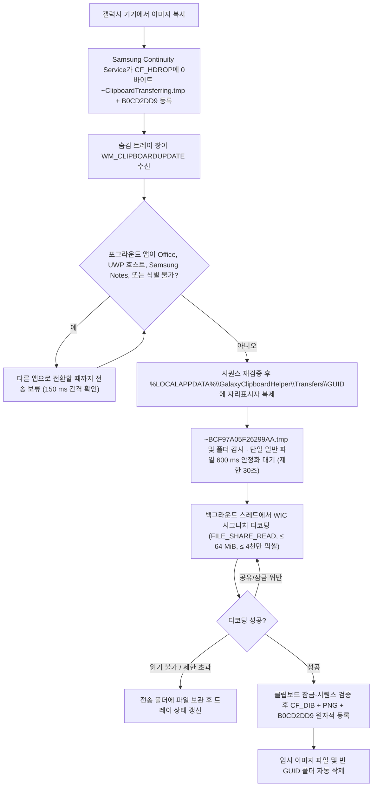

<div align="center">

# Galaxy Clipboard Helper

**삼성 갤럭시 연속성(Continuity) 클립보드의 임시 자리표시자를 실제 Windows 이미지(`PNG` · `CF_DIB`)로 자동 변환해, 어느 앱에서나 `Ctrl+V`가 바로 동작하게 만드는 초경량 시스템 트레이 도우미**

[-0078D4?style=flat-square&logo=windows&logoColor=white)](#요구-사항)
[](#소스에서-빌드하기)
[-2EA44F?style=flat-square)](#주요-기능)
[](#주요-기능)
[](../LICENSE)

[English](../README.md) · **한국어**

[왜 필요한가요?](#왜-필요한가요) · [주요 기능](#주요-기능) · [동작 원리](#동작-원리) · [시작하기](#시작하기) · [시스템 트레이 메뉴](#시스템-트레이-메뉴) · [아키텍처](#아키텍처) · [문제 해결 및 FAQ](#문제-해결-및-faq)

</div>

---

**Galaxy Clipboard Helper**는 Rust(Win32 + WIC)로 작성된 단일 실행 파일 기반 Windows 시스템 트레이 유틸리티입니다. Samsung Continuity Service의 클립보드 이미지 공유를 백그라운드에서 감지하고, 삼성의 임시 자리표시자 파일을 표준 `PNG` 및 `CF_DIB` 이미지로 자동 등록합니다. 키보드 후킹, 가짜 `Ctrl+V` 입력, 탐색기 창 자동화, 삼성 바이너리 수정 없이 동작합니다.

## 왜 필요한가요?

갤럭시 스마트폰이나 태블릿에서 **클립보드 공유**(`Samsung Continuity Service`)를 켜고 이미지를 복사해도, Windows 클립보드에는 곧바로 `PNG`나 비트맵 데이터가 들어오지 않습니다. 대신 삼성 서비스가 **0바이트 자리표시자 파일**(`~ClipboardTransferring.tmp`)을 파일 드롭(`CF_HDROP`) 포맷과 삼성 동기화 태그(`B0CD2DD9`)로 올려둡니다.

삼성 서비스는 이 자리표시자 파일이 실제 대상 폴더에 복제될 때(예: 파일 탐색기 붙여넣기, Office/Samsung Notes 전용 연동 등) 비로소 갤럭시 기기에서 원본 이미지를 전송합니다.

| 붙여넣기 대상 (`Ctrl+V`) | Galaxy Clipboard Helper 미사용 시 | Galaxy Clipboard Helper 사용 시 |
| :--- | :--- | :--- |
| **브라우저·웹 앱** (Chrome, Edge, Notion, Figma, Discord, Slack) | `.tmp` 파일 경로가 전달되거나 붙여넣기 실패 | 투명도까지 보존된 실제 **`PNG`** 이미지로 바로 붙여넣기 |
| **이미지 편집기·Win32 앱** (그림판, 편집기, 메신저 등) | `.tmp` 파일 드롭을 인식하지 못해 실패 | 표준 **`CF_DIB`** 비트맵 또는 **`PNG`**로 정상 붙여넣기 |
| **Microsoft Office · Samsung Notes** | 삼성 기본 직접 삽입 동작 | **기존대로 정상 동작** — 해당 앱 활성 시 전송을 자동 보류 |
| **런타임·백그라운드 부하** | — | **~332 KiB** 단일 `.exe`, 이벤트 기반(`WM_CLIPBOARDUPDATE`), 유휴 시 폴링 없음 |

## 주요 기능

- **비침습적 네이티브 전송 트리거** — 임시 폴더에 자리표시자 파일을 복제해 삼성 서비스 자체의 원격 전송을 자연스럽게 시작합니다. 전역 키보드 후킹, 가상 키 입력, 탐색기 자동화, 삼성 바이너리 변조를 일절 사용하지 않습니다.
- **고품질 듀얼 포맷 등록 (`PNG` + `CF_DIB`)** — 확장자가 아닌 실제 파일 시그니처를 Windows Imaging Component(WIC)로 판별해 디코딩합니다. 투명도(알파), 그레이스케일, 인덱스 팔레트, 16비트 색 깊이 및 DPI 해상도를 유지한 **`PNG`**와 호환성이 뛰어난 top-down 24비트 BGR **`CF_DIB`**를 함께 등록합니다.
- **재동기화 루프 방지** — 변환된 클립보드 항목에도 삼성 태그(`B0CD2DD9`)를 유지해 Galaxy Connect가 이미지를 다시 폰으로 역전송하지 않도록 막습니다.
- **스마트 포그라운드 앱 보류 (UAC 대응)** — `WINWORD`, `EXCEL`, `POWERPNT`, `APPLICATIONFRAMEHOST`(UWP 앱), `*SamsungNotes*`가 활성 창일 때는 전송을 자동 보류하고, 다른 앱으로 전환하는 즉시 전송을 시작합니다. 관리자 권한(UAC/PPL) 창도 `ToolHelp32` 스냅샷 폴백으로 안전하게 식별합니다.
- **외부 의존성 없는 초경량 단일 실행 파일** — 공식 `windows` 크레이트 단 하나만 사용해 빌드되며(`~332 KiB` LTO/strip 릴리스 `.exe`), Windows 기본 내장 시스템 DLL 9개만 참조합니다. `.NET`, Visual C++ 재배포 패키지, MinGW DLL 설치 없이 바로 실행됩니다.
- **네이티브 Win32 UX 완성도** — Per-Monitor V2 DPI 대응, `shell32.dll` 내장 매니페스트를 통한 Common Controls v6 시각 스타일 활성화, `explorer.exe` 재시작 시 트레이 아이콘 자동 복구(`TaskbarCreated`), 팝업 메뉴가 열린 상태에서의 실시간 상태 텍스트 갱신을 지원합니다.
- **안전 중심 설계** — 자리표시자 복제 전과 클립보드 쓰기 직전(`OpenClipboard` 잠금 내부)에 클립보드 시퀀스 번호를 재검증하고, 디렉터리·NTFS 재분석 지점(심볼릭 링크)을 차단합니다. 파일 크기(`64 MiB`) 및 픽셀 수(`40,000,000`픽셀) 상한을 두며, 완료된 임시 파일은 자동 정리하고 실패·초과·다중 항목은 손실 없이 전송 폴더에 보관합니다.

## 동작 원리



### 단계별 상세 흐름

1. **세션 단위 단일 실행**: `Local\GalaxyClipboardHelper` 네임드 뮤텍스를 획득해 같은 Windows 세션에서 중복 실행되지 않도록 보장합니다.
2. **자리표시자 감지**: `WM_CLIPBOARDUPDATE` 알림을 받아 `CF_HDROP`에 `%ProgramData%\Samsung\SamsungContinuityService\ClipBoard\~ClipboardTransferring.tmp`(0바이트) 단일 파일과 삼성 태그(`B0CD2DD9`)가 함께 존재하는지 확인합니다.
3. **포그라운드 앱 보류**: 현재 활성 창의 실행 파일 이름을 확인해 `WINWORD`, `EXCEL`, `POWERPNT`, `APPLICATIONFRAMEHOST`, 이름에 `SamsungNotes`가 포함된 프로세스이거나 식별할 수 없는 경우, 사용자가 다른 앱으로 전환할 때까지 전송 시작을 보류합니다.
4. **전송 요청 및 안정화 대기**: 클립보드 시퀀스 번호를 다시 검증한 뒤 `%LOCALAPPDATA%\GalaxyClipboardHelper\Transfers\<GUID>` 폴더에 자리표시자를 복제해 삼성의 원격 파일 전송을 유발합니다. 수신 마커(`~BCF97A05F26299AA.tmp`)와 대상 폴더를 감시하며, 디렉터리나 재분석 지점이 아닌 단일 파일의 경로·크기·수정 시각이 **600ms** 동안 변하지 않을 때까지 대기합니다(제한 시간 **30초**). 도중에 사용자가 PC에서 다른 내용을 복사하면 진행 중인 전송을 즉시 취소합니다.
5. **백그라운드 WIC 디코딩**: 별도 작업 스레드에서 `FILE_SHARE_READ` 전용으로 파일을 열어(`ERROR_SHARING_VIOLATION` / `ERROR_LOCK_VIOLATION` 시 자동 재시도) 용량(`<= 64 MiB`)과 해상도(`<= 40,000,000`픽셀)를 검사한 뒤 확장자가 아닌 실제 바이트 시그니처로 디코딩합니다.
6. **원자적 클립보드 등록 및 정리**: 디코딩 완료 신호(`WM_DECODE_DONE`)를 UI 스레드로 전달하고, `OpenClipboard` 잠금 안에서 시퀀스 번호를 재검증한 뒤 `CF_DIB`, `PNG`, `B0CD2DD9`를 등록합니다. 클립보드가 일시적으로 사용 중(`Busy`)이면 디코딩 결과를 메모리에 유지한 채 다음 150ms 주기에 재시도합니다. 등록이 끝나면 임시 파일과 빈 GUID 폴더를 삭제합니다.

## 시작하기

### 요구 사항

- **OS**: 64비트 Windows 10 또는 Windows 11 (`x86_64`)
- **Samsung Continuity Service**: PC에 설치·실행 중이며 갤럭시 기기와 클립보드 공유가 연결된 상태
- **추가 이미지 코덱 (선택)**: **HEIC**, **AVIF**, **WebP** 등 확장 포맷을 디코딩하려면 대상 PC에 해당 Windows WIC 코덱 확장(Microsoft Store 제공)이 설치되어 있어야 합니다.

### 소스에서 빌드하기

사전 요구 사항: [Rust 툴체인](https://www.rust-lang.org/tools/install) **1.85+** (Edition 2024).

```powershell
git clone https://github.com/minmul07/galaxy-continuity-image-paste-fix.git
cd galaxy-continuity-image-paste-fix

# 단위 테스트 및 상태 머신 테스트 20개 실행
cargo test

# 단일 릴리스 실행 파일(~332 KiB) 빌드
cargo build --release
```

빌드가 완료되면 아래 경로에 단일 실행 파일이 생성됩니다.

```text
target\release\galaxy-clipboard-helper-rust.exe
```

> [!TIP]
> **포터블 배포**: `galaxy-clipboard-helper-rust.exe` 파일 하나만 원하는 폴더나 다른 Windows 10/11 PC로 복사해 바로 실행할 수 있습니다. **`Run at Windows login`**은 현재 실행 파일의 경로를 레지스트리에 기록하므로, `.exe`를 최종 보관할 폴더로 옮긴 뒤 자동 실행을 켜는 것을 권장합니다.

#### 툴체인 안내 (`windows = "0.58"`)

`x86_64-pc-windows-msvc`뿐만 아니라 단독 설치된 `x86_64-pc-windows-gnu` 툴체인에서도 외부 `dlltool.exe` / `as.exe` 없이 바로 빌드되도록 `windows = "0.58"`(`windows-targets` 정적 임포트 라이브러리 사용)을 기준으로 구성했습니다. `windows = "0.62"` 마이그레이션 계획은 [docs/BACKLOG.md](./BACKLOG.md)를 참고하세요.

## 시스템 트레이 메뉴

Windows 작업 표시줄 알림 영역의 트레이 아이콘을 우클릭하면 다음 메뉴가 표시됩니다.

> [!NOTE]
> 앱 내부의 트레이 메뉴와 상태 메시지는 단순성과 글로벌 호환성을 위해 영어 단일 UI로 제공됩니다.

| 메뉴 항목 (UI) | 동작 |
| :--- | :--- |
| *(상단 비활성 상태 표시줄)* | 현재 감시·전송 상태 또는 복사된 이미지 해상도 표시 (메뉴가 열린 상태에서도 실시간 갱신) |
| **`Run at Windows login`** | `HKCU\Software\Microsoft\Windows\CurrentVersion\Run`의 `GalaxyClipboardHelper` 항목 토글 (기본값 꺼짐) |
| **`Open transfers folder`** | `%LOCALAPPDATA%\GalaxyClipboardHelper\Transfers` 폴더를(없으면 생성 후) 탐색기로 열기 |
| **`Exit`** | 클립보드 감시와 트레이 아이콘을 정리하고 앱 종료 (켜 둔 로그인 자동 실행 항목은 유지) |

<details>
<summary><strong>트레이 상태 메시지 안내 (전체 8종)</strong></summary>

| 상태 문구 (UI) | 설명 |
| :--- | :--- |
| `Monitoring Galaxy clipboard` | 유휴 상태에서 Samsung Continuity 클립보드 변경을 대기 중 |
| `Switch to another app to start transfer` | 자리표시자를 감지했으나 보류 대상 앱(Office / UWP / Samsung Notes) 또는 식별 불가 창이 포그라운드여서 대기 중 |
| `Waiting for Galaxy image transfer` | 자리표시자를 복제해 삼성 서비스의 실제 파일 수신을 기다리는 중 |
| `Image copied to clipboard (W × H)` | 가로 `W` × 세로 `H` 픽셀 이미지를 디코딩해 `CF_DIB`와 `PNG`로 등록 완료 |
| `Transfer timed out · Copy again on Galaxy` | 30초 안에 파일 전송이 완료되지 않음 |
| `Multiple items saved in transfers folder` | 파일이 여러 개이거나 하위 폴더·재분석 지점이 전달되어 전송 폴더에 그대로 보관함 |
| `Unreadable file saved in transfers folder` | 이미지 디코딩 실패, 미설치 WIC 코덱, 또는 64 MiB / 4천만 픽셀 제한 초과로 전송 폴더에 원본을 보관함 |
| `Transfer error · Copy again on Galaxy` | 전송 중 예기치 않은 파일 시스템 또는 Win32 I/O 오류 발생 |

</details>

## 아키텍처

`windows` 크레이트 외의 외부 의존성 없이 Win32 I/O 계층과 테스트 가능한 상태 머신을 명확히 분리해 구성했습니다.

```text
galaxy-continuity-image-paste-fix/
├── Cargo.toml           # 단일 의존성(`windows = "0.58"`) 및 크기 최적화 릴리스 프로파일
├── docs/
│   ├── README.ko.md     # 한국어 문서
│   └── BACKLOG.md       # `windows` 0.58 -> 0.62 마이그레이션 체크리스트
└── src/
    ├── main.rs          # DPI 인식, ComCtl v6 시각 스타일, 단일 실행 뮤텍스, STA COM 초기화
    ├── tray.rs          # 숨김 도구 창, 트레이 아이콘, TaskbarCreated 복구, 실시간 팝업 메뉴
    ├── transfer.rs      # 결정적 `TransferController` 상태 머신 및 백그라운드 디코드 조율
    ├── clipboard.rs     # `ClipboardBackend` 트레이트, Win32 클립보드 I/O, ToolHelp32 폴백
    ├── image.rs         # 시그니처 기반 WIC 디코더, 원본 포맷 보존 PNG 및 24비트 CF_DIB 인코더
    ├── startup.rs       # `HKCU\...\Run` 시작 프로그램 토글 및 탐색기 열기
    └── winutil.rs       # RAII 가드(`ComGuard`, `HandleGuard`, `VisualStylesGuard`) 및 Win32 유틸
```

### 검증 및 테스트

`TransferController`는 `ClipboardBackend` 트레이트를 통해 실제 OS 클립보드와 분리되어 있어, 사용자의 실제 클립보드를 건드리지 않고도 경합·재시도·시간 초과·정리 시나리오를 결정적으로 검증합니다.

```powershell
cargo fmt --check
cargo clippy --all-targets -- -D warnings
cargo test
```

총 **20개의 자동화 테스트**가 BMP/PNG 라운드트립, 확장자 무관 시그니처 디코딩, 그레이스케일·인덱스·16비트 PNG 포맷 보존, 배타적 잠금 재시도, 파일/픽셀 상한 검증, 포그라운드 프로세스 필터링 및 `ToolHelp32` 폴백, 팝업 메뉴 상태 갱신, 전체 전송 상태 머신 흐름을 검증합니다.

## 문제 해결 및 FAQ

<details>
<summary><strong>트레이에 "Switch to another app to start transfer"가 계속 표시돼요.</strong></summary>

Microsoft Word(`WINWORD`), Excel(`EXCEL`), PowerPoint(`POWERPNT`), UWP 호스트(`ApplicationFrameHost`), Samsung Notes(`*SamsungNotes*`)가 활성 창일 때는 삼성 서비스의 기본 직접 붙여넣기를 방해하지 않도록 전송을 보류합니다. Chrome, 그림판, Slack 등 이미지를 붙여넣을 다른 앱으로 창을 전환하면 즉시 전송이 시작됩니다.

</details>

<details>
<summary><strong>HEIC, AVIF, WebP 이미지가 변환되지 않고 전송 폴더에 남아요.</strong></summary>

이미지 디코딩에 Windows Imaging Component(WIC)를 사용합니다. PNG, JPEG, BMP, GIF, TIFF는 기본 지원되며, HEIC·AVIF·WebP 등은 Microsoft Store에서 해당 Windows 이미지 확장 코덱을 설치해야 디코딩됩니다. 변환에 실패한 파일은 삭제되지 않으므로 트레이 메뉴의 **`Open transfers folder`**에서 원본을 바로 확인할 수 있습니다.

</details>

<details>
<summary><strong><code>.exe</code> 파일 위치를 옮겼더니 로그인 시 자동 실행이 안 돼요.</strong></summary>

`Run at Windows login`은 토글 시점의 실행 파일 경로를 `HKCU\Software\Microsoft\Windows\CurrentVersion\Run`에 기록합니다. 새 위치에서 `.exe`를 실행한 뒤 `Run at Windows login`을 한 번 껐다가 다시 켜면 경로가 갱신됩니다.

</details>

<details>
<summary><strong>완전히 제거하려면 어떻게 하나요?</strong></summary>

1. 트레이 아이콘을 우클릭해 **`Run at Windows login`** 체크를 해제합니다(켜 둔 경우).
2. **`Exit`**를 눌러 앱을 종료합니다.
3. `galaxy-clipboard-helper-rust.exe` 파일을 삭제합니다.
4. *(선택)* 보관된 전송 파일까지 지우려면 `%LOCALAPPDATA%\GalaxyClipboardHelper` 폴더를 삭제합니다.

</details>

## 로드맵

- `windows = "0.58"`(`windows-targets`)에서 `windows = "0.62"`(`windows-link` / `raw-dylib`)로 마이그레이션 — 자세한 선행 조건과 코드 변경 체크리스트는 [docs/BACKLOG.md](./BACKLOG.md)를 참고하세요.

## 라이선스

[MIT License](../LICENSE)에 따라 배포됩니다 — Copyright (c) 2026 Eo SeungKyung.
